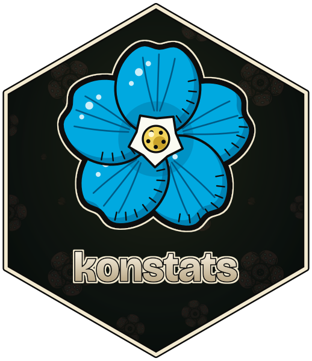

# konstats 

[](https://github.com/mcanzi/konstats/actions/workflows/R-CMD-check.yaml)

konstats is the companion package of my courses *Statistics* and *Advanced Statistics* at the Department of Linguistics, University of Konstanz. It is written for their students and is not meant for general use; the data sets of the courses are in [simling](https://mcanzi.de/simling/), which anyone can use.

## Installation

```r
# install.packages("remotes")
remotes::install_github("mcanzi/konstats")
```

This also installs every package the Statistics course uses, simling included. For Advanced Statistics, install its extra packages once:

```r
konstats::install_course("advanced")
```

Before the first session, check that your computer is ready:

```r
library(konstats)
check_setup("statistics")
check_setup("advanced")
```

## Usage

### Lectures and slides

`lectures()` lists the lectures of both courses, with their textbook chapters and data sets. `slides()` opens the slides of one, by number or by part of its topic:

```r
lectures("statistics")
slides(4)
slides("random forests", course = "advanced")
```

### Exercise sheets

Each tutorial has an exercise sheet: an R Markdown file with the exercises and an empty code chunk for each answer. The last exercises are the weekly assignment. `get_tutorial()` copies a sheet into your project folder, or all of them at once:

```r
tutorials()
get_tutorial(4, ".")
get_tutorial("all", ".")
```

You write your answers in the copy, and a sheet that is already in the folder is never overwritten unless you ask.

### Weekly assignments

In RStudio, *File > New File > R Markdown > From Template > Weekly assignment (konstats)* starts the file you hand in each week, with a section per exercise.

### Helpers from the slides

The functions written in the Advanced Statistics slides are in the package too:

| Function | What it does | Session |
|---|---|---|
| `resid_acf()` | Autocorrelation of model residuals within trajectories | 3, 4 |
| `partial_dependence()` | Mean prediction of a model as one predictor changes (`partial()` in the slides) | 5, 6 |
| `cv_speakers()` | Accuracy of a random forest on speakers it has not seen | 6 |
| `theme_paper()` | A plain ggplot2 theme for papers and theses | 11 |

```r
library(simling)
m <- lm(f2 ~ time, data = price_f2)
resid_acf(residuals(m), price_f2$traj)
```

## The packages of each course

`course_packages()` lists them, with what each is used for in the course:

```r
course_packages("advanced")
```

## License

Code: MIT © Massimiliano Canzi. The exercise sheets in `inst/sheets` are course materials, © Massimiliano Canzi, licensed under [CC BY 4.0](https://creativecommons.org/licenses/by/4.0/).
